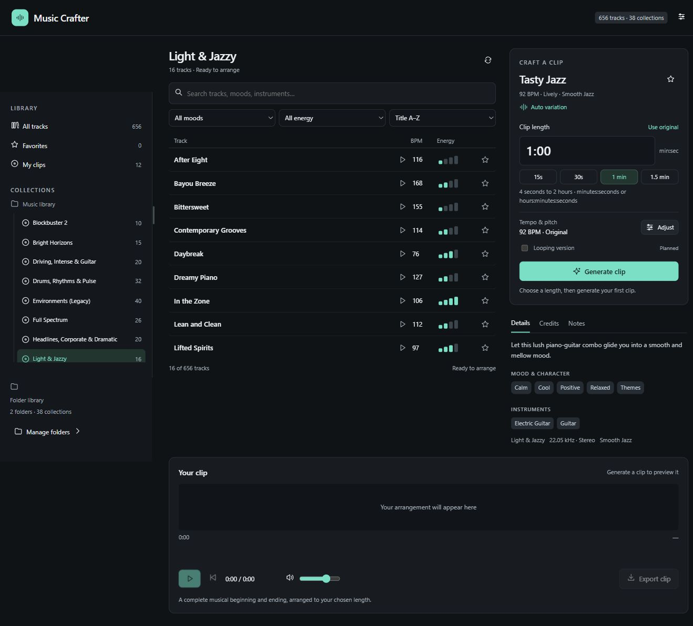
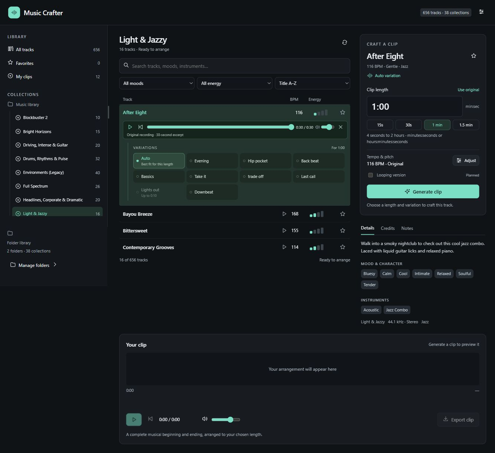

# Music Crafter

### Your music. The right length. A proper ending.

Music Crafter is a local music arranger for your own compatible SmartSound library. Browse collections, audition a track, choose an opening variation, and build a finished clip to the length your project needs. Export it as WAV or MP3, ready for your editor.

**Runs on your computer · Browser interface · No cloud account · Original music stays read-only**



*Screenshots show the real application with a privately owned library. Music, arrangement maps and catalog databases are not included. Metadata richness depends on the files available locally.*

## What you can do

- **Find the right track:** browse collections, search, filter by mood or energy, sort by title or tempo, and save favorites.
- **Listen before arranging:** preview up to 30 seconds inline, with pause, seek, volume and restart controls.
- **Choose your opening:** variations appear beneath the selected track; options that cannot fit the requested length are marked unavailable.
- **Fit your project:** create clips from **4 seconds to 2 hours**, using complete musical sections and a recorded ending where available.
- **Shape the sound:** adjust tempo from 80–120% and change pitch independently, then regenerate.
- **Keep your work:** generated arrangements live in **My clips**; notes, favorites and export preferences stay local.
- **Work with larger libraries:** scan local folders or Windows shares in the background, without copying the entire audio library.

## From a track to a finished clip

1. **Browse** a collection and select a track. Drag the Collections divider to give long names more room.
2. **Preview** using the play button in the track row. Pause once to stop; play again to resume.
3. **Choose a variation**, or leave **Auto** selected for the best available fit. Changing a variation cues its opening in the inline preview.
4. **Set the length.** Enter `30`, `0:30`, `1:30`, or `1:05:00`. `65:00` also means 65 minutes. Fields accept digits and colons; seconds and the middle minutes field must be below 60.
5. **Generate clip**, then listen to the result and inspect its musical sections.
6. **Export clip** as WAV or MP3, choosing the quality your project needs.



Previewing a source excerpt does not create a saved arrangement. Changing length, variation, tempo or pitch requires generating a new clip to hear the arranged result.

## Get started on Windows

You need:

| Requirement | Details |
| --- | --- |
| Python | **64-bit Python 3.10+**; tested with Python 3.12 |
| NumPy | Install into the project environment with `requirements.txt` |
| FFmpeg | Supply separately for duration fitting, tempo/pitch processing, resampling and MP3 export; use a build with `libmp3lame`. Rubber Band support is preferred, with an `atempo` fallback. |
| Music | Your own compatible SmartSound audio and arrangement files |
| Browser | A current desktop browser; developed and checked in Chrome |

### 1. Get the application and Python dependencies

Clone or download this repository. In PowerShell, inside the application folder:

```powershell
git clone https://github.com/jimerb/Music-Crafter.git
cd Music-Crafter
py -3 -m venv .venv
.\.venv\Scripts\python.exe -m pip install -r requirements.txt
```

If you downloaded the ZIP, extract it and run only the last two commands from the extracted folder. These commands install dependencies into `.venv`, not globally. If `py` is unavailable, use the full path to your existing Python executable for the environment-creation command.

### 2. Supply FFmpeg

Obtain FFmpeg from a distribution linked by the [FFmpeg download page](https://ffmpeg.org/download.html). Choose one of these locations:

- Put `ffmpeg.exe` in a new `app/tools` folder.
- Point `MUSIC_CRAFTER_FFMPEG` to an existing executable.
- Use an existing `ffmpeg` on your `PATH`.

Keep the distribution's license notices with your local copy. This repository does not redistribute FFmpeg, FFprobe, Python, NumPy or their installers. FFprobe is optional and is used only for extra test checks when present locally.

### 3. Start Music Crafter

Double-click **Start Music Crafter.cmd**. It opens **http://127.0.0.1:8768/**.

The launcher checks `MUSIC_CRAFTER_PYTHON`, then `.venv`, an existing Codex-bundled runtime if present, and finally Python on `PATH`. Codex is not required. To select another existing runtime in PowerShell:

```powershell
$env:MUSIC_CRAFTER_PYTHON = 'C:\Python312\python.exe'
.\Start-MusicCrafter.ps1
```

For a foreground server:

```powershell
.\.venv\Scripts\python.exe app/run.py
```

The first checkout opens with an empty library. Go to **Settings → Folders**, add a parent folder containing your collections, and let the scan finish. Network shares must be readable by the Windows account running the server. Choose **Rescan** after adding music. **Remove** disconnects a folder without deleting its files.

Double-click **Stop Music Crafter.cmd** to stop a launcher-started server. Closing the browser does not stop it. Use Ctrl+C for a foreground server. Keep the default loopback address: this is a local application without user authentication, not a public hosting service.

## Export choices

| Format | Options |
| --- | --- |
| WAV | Original sample rate, 44.1, 48 or 96 kHz; 16-, 24- or 32-bit PCM |
| MP3 | 128, 192, 256 or 320 kbps |

Higher export sample rates cannot restore detail absent from the source. MP3 export uses headroom to reduce reconstruction clipping and handles encoder padding. Long clips need more processing time, memory and local disk space.

## Library compatibility and limitations

The reader supports legacy binary `.blk` arrangement maps and supported XML `.blx` maps, paired with 16-bit mono or stereo PCM `.sds` recordings in RIFF/SDSS containers. Keep the collection's folder structure intact. The scanner reports unsupported or missing files; compatibility with every SmartSound release or newer container is not promised.

Titles and arrangement sections can be read without a catalog database. Rich descriptions, moods, credits and known tempos shown in the screenshots come from optional local catalog data. The current reader can use an existing `analysis/metadata_sources/Master.ssdb` and legacy `analysis/output/light_jazzy_ux_metadata.json` snapshot when present; neither is supplied or needed to launch. Without them, some descriptive fields and filters have less information.

Music Crafter follows authored section connections, preserves continuous neighboring sections, smooths new joins and fits the result to the requested duration. Very short clips can require a noticeable speed adjustment. Ambient effects use their authored connections and fade out at the requested length. **Phrase-perfect looping exports are planned**, and the looping control is currently disabled.

This is an independent arranger, not the Sonicfire engine or an official SmartSound product. Bring your own library and follow its license for any exported music. Publishing this application does not grant rights to the recordings or catalog content.

## Local data and privacy

Runtime files are created under `app/data`: library roots, indexes, favorites, notes, generated clips, previews, logs and process IDs. Back up that folder if you want to preserve your work. Audio sources are read in place; scans inspect maps, metadata and headers, and generation reads the sections it needs.

The repository includes application code, launchers, tests and curated screenshots only. Ignore rules exclude music, proprietary library files and catalog databases, runtime state, exports, investigation material, credentials, caches and third-party binaries. Review any new files before broadening those rules.

## Development and tests

The backend is Python/NumPy; the frontend is plain HTML, CSS and JavaScript with no frontend build step.

```text
app/                 HTTP server, library reader, arranger and audio codecs
app/static/          Browser interface
app/data/            Local runtime state (created automatically; ignored)
app/tools/           Optional local FFmpeg installation (ignored)
tests/               Synthetic tests and optional private-library integration tests
docs/screenshots/    Curated real-app screenshots
```

Run from the repository root:

```powershell
.\.venv\Scripts\python.exe -m unittest discover -s tests -v
```

Portable tests generate their own audio and arrangement fixtures. They cover parsing, safe source reading, long clips, WAV/MP3 processing and empty-library startup. Tests that need an optional private music fixture explicitly skip when it is absent; codec-specific tests skip when the relevant FFmpeg capability is unavailable. No proprietary test audio is distributed.

If startup fails, check `app/data/server-errors.log` and confirm the selected Python can import NumPy. If generation or MP3 export reports a missing codec, check the FFmpeg location and build capabilities. If no tracks appear, check the library folder's readability and supported arrangement/audio pairs in **Settings → Folders**.
